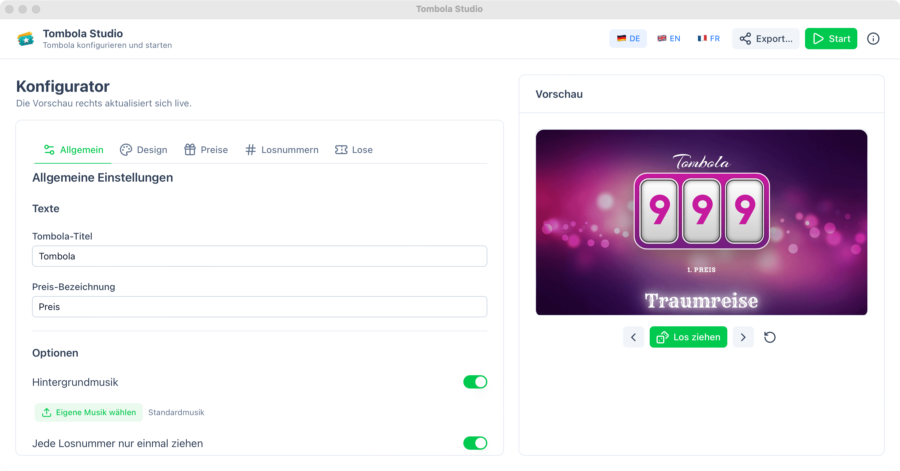

# Tombola Studio

Tombola Studio is a ready-to-use tombola / raffle app for Windows, macOS and Linux.
Set up your game, press start, and draw winning numbers live on a screen — at festivals,
weddings, school events, company parties, or any public event.

**Good to know:** the finished app is standalone. There is nothing to install.
Download it, start it, and go.



---

## What does the app do?

Tombola Studio runs your whole raffle for you:

- **Set up your game** — add prizes, choose how many tickets exist, pick a nice theme and background music.
- **Generate and print tickets** — create all ticket numbers and export them as a print-ready PDF or CSV (9 ticket designs included).
- **Draw numbers live** — press "Spin" in full screen and the app picks the winner. Everyone can watch.
- **Keep control** — draw each number only once, skip numbers you don't need, and set "fixed numbers" if a specific guest should win a specific prize.
- **Everything is saved** — your last setup is remembered when you open the app again.
- **Play on any device** — export your game as a **single HTML file** and open it in any
  browser: laptop, tablet, phone, smart TV. No app, no install, no internet needed.
- **Works in English, German and French.**

No internet connection needed. Your event, your data, your machine.

### Play it anywhere: export as a single HTML file

Don't want to take your laptop to the stage? No problem.

With one click, Tombola Studio saves your whole game — prizes, ticket numbers, theme,
background image and music — into **one single HTML file**. Copy that file to any device,
double-click it, and it opens in the normal browser. That's all.

There is nothing to install, no internet connection is needed, and it works on every
device with a browser: Windows, macOS, Linux, Android, iPhone, iPad, smart TVs.

---

## Why does this project exist?

This is not an AI fun project. We started as a hobby project with a simple handwritten
web app — but it stayed hard to configure for normal people. Since there was heavy demand
for it, we decided to build a proper end-user friendly desktop app that includes everything.

The tombola has been used at many public events. It is well tested and works great.

The only thing we cannot provide is a good game moderator ;-)

---

## Download and run (no installation needed)

1. Download the version for your system from the [Releases](../../releases) page.
2. Start the file. That's it — there is no installer and no setup.

| Your system | File to download |
|---|---|
| Windows (64-bit) | `Tombola Studio-…-win-x64.zip` (unzip, then run `tombola-studio-win_x64.exe`) |
| macOS (Apple M1/M2/M3…) | `Tombola Studio-…-mac-arm64.dmg` or `.zip` |
| macOS (Intel) | `Tombola Studio-…-mac-x64.dmg` or `.zip` |
| Linux (64-bit) | `Tombola Studio-…-linux-x64.zip`, `.AppImage` or `.deb` |

**First start on macOS:** if the app doesn't open, right-click it → **Open** → **Open**
once. After that it opens normally. (Same on Windows if Windows shows a blue warning box:
click "More info" → "Run anyway".)

---

## Where does the app store my settings?

Your setup is saved automatically on your own computer, in one simple file.
You never need to touch it — but it's good to know it exists.

| System | Folder |
|---|---|
| Windows | `C:\Users\<your name>\AppData\Roaming\Tombola Studio` |
| macOS | `/Users/<your name>/Library/Application Support/Tombola Studio` |
| Linux | `/home/<your name>/.config/Tombola Studio` |

Inside that folder:

- `tombola-settings.json` — all your settings (prizes, ticket numbers, theme, …)
- `custom-music.…` — your own music file, if you picked one

**Tips:**

- Settings stay when you update to a new app version.
- Want a completely fresh start? Delete the `Tombola Studio` folder above.

---

## Buzzer project (coming soon)

We also built a hardware **buzzer**! The buzzer connects to the app via **BLE**
(Bluetooth Low Energy — the same low-power Bluetooth as fitness bracelets) and lets the
players or host control the game.

---

## For developers

### 1. Clone the repository

```bash
git clone https://github.com/<your-username>/tombola-studio.git
cd tombola-studio
```

### 2. Run the app in development mode

You need [Node.js](https://nodejs.org/) **20 or newer**.

```bash
npm install   # install all needed tools (first time only)
npm run dev   # starts the app with the developer window
```

Press `Ctrl+C` (or `Cmd+C`) in the terminal to stop it.
To just run the app without the developer window, use `npm start`.

### 3. Build the finished apps (binaries)

```bash
npm run dist:mac     # builds .dmg + .zip for Intel and Apple silicon (on a Mac)
npm run dist:win     # builds the Windows .zip (a setup .exe too, if NSIS is installed)
npm run dist:linux   # builds .zip (+ .AppImage and .deb, if those tools are installed)
npm run dist         # builds for all systems at once
```

Every finished file lands in the **`dist/`** folder in the project.
Each binary is one self-contained file with the whole app inside — you can copy it
to any computer and run it. No installation needed.

Small notes for building:

- `.dmg` files are created on macOS. The app is still signed, just not with a paid
  Apple certificate, which is why macOS shows the right-click → Open hint above.
- The Windows installer (`…-setup.exe`) is only created when `makensis` is installed;
  the portable `.zip` is always created.
- `.AppImage` needs `appimagetool`, `.deb` needs `dpkg-deb`. Without them you still get
  the portable `.zip`.

### Project layout (short)

- `src/` — the whole app (Vue 3 + Nuxt UI)
- `scripts/dist.mjs` — builds and packages the apps for all systems
- `neutralino.config.json` — app settings for the Neutralinojs framework
- `dist/` — where finished apps appear after building

---

## License

[MIT](LICENSE) — free to use, free to share.

See you at the next tombola — and don't forget the moderator ;-)
